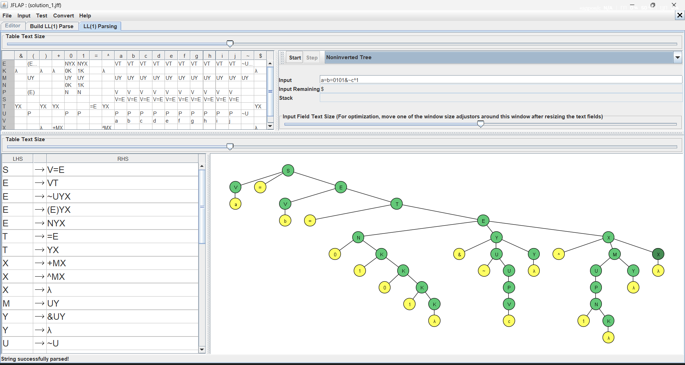
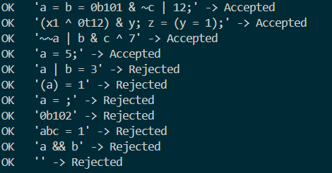
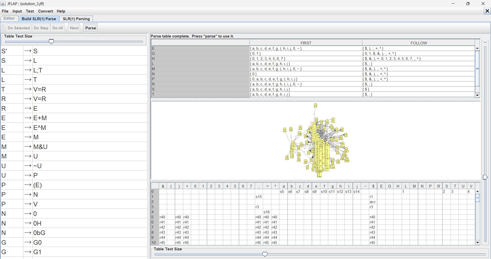
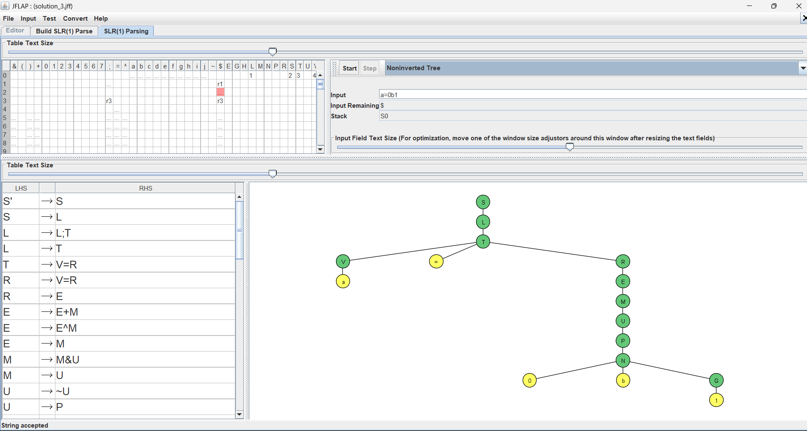

# Практическая работа №5

## Цели и задачи

Исследование контекстно-свободных грамматик и алгоритмов синтаксического анализа контекстно-свободных языков.

## Задание

1. Необходимо с использованием системы JFLAP, построить LL(1) грамматику, описывающую заданный язык, или формально доказать невозможность этого. Полученная грамматика не должна повторять SLR(1) грамматику, конструируемую в части 3. Ассоциативность операций на усмотрение разработчика. Язык оператора присваивания, в правой части которого задано «побитовое» выражение. Элементами выражений являются целочисленные константы в двоичной системе счисления, имена переменных из одного символа (от a до j), знаки операций и скобки для изменения порядка вычисления подвыражений. Операции (в сторону уменьшения приоритета): отрицание, мультипликативные, аддитивные, присваивание.

2. Предложить программную реализацию метода рекурсивного спуска для распознавания строк заданного языка. Представить формальное доказательство принадлежности к классу LL(1) грамматики, лежащей в основе синтаксического анализа заданного языка. Во всех случаях язык должен состоять из последовательностей выражений. В качестве разделителя может выступать символ новой строки, точка с запятой или любой другой символ, не задействованный в других лексемах. Ассоциативность операций на усмотрение разработчика. Результатом работы синтаксического анализатора является выдача сообщения «Accepted» или «Rejected». Язык «побитовых» выражений, элементами которых являются целочисленные константы в двоичной, троичной или десятичной системах счисления, имена переменных из 1-2 символов, знаки операций и скобки для изменения порядка вычисления подвыражений. Операции (в сторону уменьшения приоритета): отрицание, мультипликативные, аддитивные, присваивание.

3.  Необходимо с использованием системы JFLAP, построить SLR(1) грамматику, описывающую заданный язык, или формально доказать невозможность этого. Во всех случаях реализуется язык, состоящий из последовательностей операторов присваивания. В качестве разделителя может выступать символ новой строки, точка с запятой или любой другой символ, не задействованный в прочих лексемах. В качестве L-значения оператора присваивания выступает только имя переменной. В правой части оператора присваивания указывается выражение, элементы которых оговариваются в каждом варианте задания. Ассоциативность операций на усмотрение разработчика. Полученная грамматика не должна повторять LL(1)-грамматику, конструируемую в части 1. Элементами «побитового» выражения являются целочисленные константы в 2- и 8-чной системах счисления, имена переменных из одного символа (от a до j), знаки операций и скобки для изменения порядка вычисления подвыражений. Операции (в сторону уменьшения приоритета): отрицание, мультипликативные, аддитивные, присваивание.

## Немного теории

**LL(1)-грамматика** разбирается сверху вниз с просмотром одного символа. Она
не может быть леворекурсивной и должна быть левофакторизована. Условие для
каждого нетерминала `A` с альтернативами `A → α₁ | α₂ | …`: множества выбора
`SELECT(A → αᵢ) = FIRST(αᵢ)`, а если `αᵢ` выводит `λ`, то ещё и `FOLLOW(A)`,
не должны попарно пересекаться. Именно из этого условия получается
предсказывающая таблица, а из неё программа рекурсивного спуска: один метод
на нетерминал, выбор ветки по текущему токену.

**SLR(1)-грамматика** разбирается снизу вверх (сдвиг/свёртка). Строится
автомат LR(0). Свёртка по `A → α.` допускается только по символам из
`FOLLOW(A)`. Грамматика SLR(1), если в таблице нет конфликтов «сдвиг/свёртка»
и «свёртка/свёртка». Левая рекурсия для LR-разбора не мешает и даже удобна для
левоассоциативных операций.

**Ассоциативность.** Левая рекурсия (`E → E + M`) даёт левую ассоциативность,
правая (`R → V = R`) даёт правую. В LL(1) левая рекурсия запрещена, поэтому
операции там раскладываются в «хвосты» (`X → +MX | λ`).

---

## Задание 1. LL(1)-грамматика одного присваивания

**Язык:** `V = выражение`. Константы двоичные, переменные `a`–`j`. Аддитивные
операции `+`, `^`, мультипликативная `&`, унарная `~`. Присваивание
правоассоциативное и допускается также внутри скобок.

### Грамматика

| Нетерминал | Продукции |
|---|---|
| `S` | `V = E` |
| `E` | `V T` \| `~ U Y X` \| `( E ) Y X` \| `N Y X` |
| `T` | `= E` \| `Y X` |
| `X` | `+ M X` \| `^ M X` \| `λ` |
| `M` | `U Y` |
| `Y` | `& U Y` \| `λ` |
| `U` | `~ U` \| `P` |
| `P` | `( E )` \| `N` \| `V` |
| `N` | `0 K` \| `1 K` |
| `K` | `0 K` \| `1 K` \| `λ` |
| `V` | `a` \| `b` \| … \| `j` |

Уровни приоритета: `U` (отрицание) → `M`/`Y` (`&`) → `X` (`+`, `^`) →
`T` (`=`). Все операции левоассоциативны, кроме `=`.
Чтобы левая часть присваивания всегда была переменной, `E` левофакторизована
по первому символу: после `V` решается, стоит ли дальше `=` (`T → = E`) или
продолжается обычное выражение (`T → Y X`).

### Доказательство LL(1)

| Нетерминал | Множества выбора альтернатив | Пересечение |
|---|---|---|
| `E` | {a..j} \| {~} \| {(} \| {0,1} | нет |
| `T` | {=} \| {&,+,^} ∪ FOLLOW(T) = {&,+,^,),$} | нет |
| `X` | {+} \| {^} \| FOLLOW(X) = {),$} | нет |
| `Y` | {&} \| FOLLOW(Y) = {+,^,),$} | нет |
| `U` | {~} \| FIRST(P) = {(,0,1,a..j} | нет |
| `P` | {(} \| {0,1} \| {a..j} | нет |
| `K` | {0} \| {1} \| FOLLOW(K) = {&,+,^,),$} | нет |

Левой рекурсии нет, пересечений нет, значит грамматика LL(1). Автоматическая
проверка множеств выбора по файлу `.jff` тоже конфликтов не нашла.

### Тесты

| Строка | Ожидание | Результат |
|---|---|---|
| `a=b` | Accepted | Accepted |
| `a=b=0101&~c^1` | Accepted | Accepted |
| `a=(b=1)&c` | Accepted | Accepted |
| `a=~~(b^1)` | Accepted | Accepted |
| `a=1+0` | Accepted | Accepted |
| `a&b` (нет `=`) | Rejected | Rejected |
| `a+b=c` (левая часть не переменная) | Rejected | Rejected |
| `(a)=1` | Rejected | Rejected |
| `a=` | Rejected | Rejected |
| `a=2` (не двоичная цифра) | Rejected | Rejected |
| `a=k` (переменная вне `a`–`j`) | Rejected | Rejected |
| `=a` | Rejected | Rejected |
| `a=(b` / `a=b)` (скобки не парны) | Rejected | Rejected |
| `a=~` / `a=+b` | Rejected | Rejected |

---

## Задание 2. Рекурсивный спуск

**Язык:** последовательность выражений, разделённых `;`. Константы:
двоичные `0b…`, троичные `0t…`, десятичные. Переменные из 1–2 символов
(буква, затем буква или цифра). Аддитивные операции `|` и `^`,
мультипликативная `&`, унарная `~`, присваивание только к переменной.
Результат: `Accepted` или `Rejected`.

### Грамматика

Токены: `ID`, `NUM`, `~`, `&`, `|`, `^`, `=`, `(`, `)`, `;`, `$` (конец ввода).

| Нетерминал | Продукции |
|---|---|
| `P` | `S R $` |
| `R` | `; O` \| `λ` |
| `O` | `S R` \| `λ` |
| `S` | `ID T` \| `N M A` |
| `T` | `= S` \| `M A` |
| `N` | `~ V` \| `NUM` \| `( S )` |
| `U` | `V M` |
| `M` | `& V M` \| `λ` |
| `A` | `\|  U A` \| `^ U A` \| `λ` |
| `V` | `~ V` \| `F` |
| `F` | `ID` \| `NUM` \| `( S )` |

Лексер отдельно распознаёт числа с префиксами `0b` и `0t` и имена из 1–2
символов. Каждому нетерминалу соответствует метод класса `Parser`.

### Доказательство LL(1)

| Нетерминал | FIRST | FOLLOW |
|---|---|---|
| `S` | ID, ~, NUM, ( | ;, ), $ |
| `T` | =, &, \|, ^, λ | ;, ), $ |
| `N` | ~, NUM, ( | &, \|, ^, ;, ), $ |
| `M` | &, λ | \|, ^, ;, ), $ |
| `A` | \|, ^, λ | ;, ), $ |
| `U`, `V`, `F` | (V, F: ~/ID/NUM/(; U: как V) | &, \|, ^, ;, ), $ |
| `R` | ;, λ | $ |
| `O` | ID, ~, NUM, (, λ | $ |

Проверка выбора альтернатив:

| Нетерминал | Множества выбора | Пересечение |
|---|---|---|
| `S` | {ID} \| {~,NUM,(} | нет |
| `T` | {=} \| {&,\|,^} ∪ {;,),$} | нет |
| `N` | {~} \| {NUM} \| {(} | нет |
| `M` | {&} \| {\|,^,;,),$} | нет |
| `A` | {\|,^} \| {;,),$} | нет |
| `V` | {~} \| {ID,NUM,(} | нет |
| `F` | {ID} \| {NUM} \| {(} | нет |
| `R` | {;} \| {$} | нет |
| `O` | {ID,~,NUM,(} \| {$} | нет |

Все условия LL(1) выполнены, значит грамматика LL(1) и парсер детерминирован
без возвратов.

### Тесты (запуск `Solution_2.py`)

| Строка | Ожидание | Результат |
|---|---|---|
| `a = b = 0b101 & ~c \| 12;` | Accepted | Accepted |
| `(x1 ^ 0t12) & y; z = (y = 1);` | Accepted | Accepted |
| `~~a \| b & c ^ 7` | Accepted | Accepted |
| `a = 5;` | Accepted | Accepted |
| `a \| b = 3` | Rejected | Rejected |
| `(a) = 1` | Rejected | Rejected |
| `a = ;` | Rejected | Rejected |
| `0b102` | Rejected | Rejected |
| `a && b` | Rejected | Rejected |
| (пустая строка) | Rejected | Rejected |

---

## Задание 3. SLR(1)-грамматика последовательности присваиваний

**Язык:** присваивания, разделённые `;`. Левая часть только переменная.
Константы: двоичные `0b…` и восьмеричные с ведущим нулём `0…`. Аддитивные
операции `+`, `^`. Левая рекурсия даёт левую ассоциативность `+`, `^`, `&`,
а присваивание правоассоциативно. Грамматика отличается от LL(1)-варианта
из задания 1 (левая рекурсия вместо «хвостов»).

### Грамматика

| Нетерминал | Продукции |
|---|---|
| `S` | `L` |
| `L` | `L ; T` \| `T` |
| `T` | `V = R` |
| `R` | `V = R` \| `E` |
| `E` | `E + M` \| `E ^ M` \| `M` |
| `M` | `M & U` \| `U` |
| `U` | `~ U` \| `P` |
| `P` | `( E )` \| `N` \| `V` |
| `N` | `0` \| `0 H` \| `0 b G` |
| `G` | `G 0` \| `G 1` \| `0` \| `1` |
| `H` | `H d` \| `d`, где `d` ∈ {0,…,7} |
| `V` | `a` \| `b` \| … \| `j` |

### Доказательство SLR(1)

Потенциально конфликтные состояния:

| Состояние | Пункты | Почему конфликта нет |
|---|---|---|
| после `V` в `R` | `R → V . = R` и `P → V .` | `=` ∉ FOLLOW(P) = {&,+,^,;,),$}, значит по `=` сдвиг, по остальным свёртка |
| после `0` | `N → 0 .`, `N → 0 . H`, `N → 0 . b G` | свёртка только по FOLLOW(N) = {&,+,^,;,),$}, а сдвиг по цифрам 0–7 и `b` |
| после `0 H` | `N → 0 H .`, `H → H . d` | то же самое |

Построение автомата LR(0) (63 состояния) и проверка по FOLLOW показали **0
конфликтов**, то есть грамматика SLR(1).

### Тесты

| Строка | Ожидание | Результат |
|---|---|---|
| `a=0` | Accepted | Accepted |
| `a=01` | Accepted | Accepted |
| `a=0b1` | Accepted | Accepted |
| `a=0b101&~b^07` | Accepted | Accepted |
| `a=0;b=a+01;c=~c` | Accepted | Accepted |
| `a=(b)&c` | Accepted | Accepted |
| `a=b=c` | Accepted | Accepted |
| `a=0b1^~~(b&07)` | Accepted | Accepted |
| `a=1`, `a=8` (нет ведущего нуля или цифра вне 0–7) | Rejected | Rejected |
| `a=0b102` | Rejected | Rejected |
| `a=08` | Rejected | Rejected |
| `a=0b` | Rejected | Rejected |
| `a=0;` (лишний `;` в конце) | Rejected | Rejected |
| `a+b=0`, `(a)=0` | Rejected | Rejected |
| `a==0`, `a=b&&c` | Rejected | Rejected |
| `a=k` | Rejected | Rejected |
| `a=0;;b=0` | Rejected | Rejected |
| `a=`, `=a`, `a=~` | Rejected | Rejected |
| `a=(b=0)` (присваивание в скобках не поддерживается) | Rejected | Rejected |

---

## Общий вывод

- Все три грамматики реализуют заданные приоритеты: `~` выше `&`, `&` выше
  аддитивных операций, присваивание ниже всех и правоассоциативно.
- В задании 1 левая часть присваивания ограничена переменной, а LL(1)
  достигнута левой факторизацией `E` и выносом операций в «хвосты».
- Задание 2 показывает, что LL(1)-грамматика напрямую превращается в
  программу: по одному методу на нетерминал, без возвратов.
- Задание 3 использует левую рекурсию, поэтому грамматика проще для чтения и
  естественно левоассоциативна, при этом SLR(1)-конфликтов нет.
